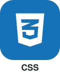
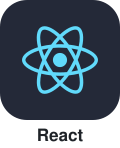
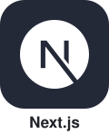
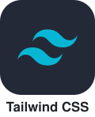
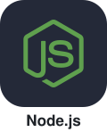
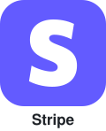

<picture>
  <source media="(prefers-color-scheme: dark)" srcset="./assets/banner-dark.svg" />
  <source media="(prefers-color-scheme: light)" srcset="./assets/banner-light.svg" />
  
</picture>

 

<a href="https://dox-glass.vercel.app">
  <picture>
    <source media="(prefers-color-scheme: dark)" srcset="./assets/button-portfolio-dark.svg" />
    <source media="(prefers-color-scheme: light)" srcset="./assets/button-portfolio-light.svg" />
    
  </picture>
</a>

 

<picture>
  <source media="(prefers-color-scheme: dark)" srcset="./assets/arrow-dark.svg" />
  <source media="(prefers-color-scheme: light)" srcset="./assets/arrow-light.svg" />
  
</picture>

## ✦ À propos

<table>
  <tr>
    <td width="56%" valign="top">
      <h3>Qui suis-je ?</h3>
      

    </td>
    <td width="44%" valign="top" align="center">
      <h3>Suivez-moi</h3>
      
      
      
      
      

      <h3>Contactez-moi</h3>
      
    </td>
  </tr>
</table>

<picture>
  <source media="(prefers-color-scheme: dark)" srcset="./assets/arrow-dark.svg" />
  <source media="(prefers-color-scheme: light)" srcset="./assets/arrow-light.svg" />
  
</picture>

## ✦ Stack technique

<b>Langages</b>
 

  

<b>Frameworks &amp; Runtime</b>
 

  

<b>Bases de données &amp; Services</b>
 

  

<b>Hébergement &amp; Cloud</b>
 

  

<b>Paiements</b>
 

  

<b>Outils</b>
 

 

<picture>
  <source media="(prefers-color-scheme: dark)" srcset="./assets/arrow-dark.svg" />
  <source media="(prefers-color-scheme: light)" srcset="./assets/arrow-light.svg" />
  
</picture>

## ✦ Travaillons ensemble

Une idée, un projet ou une question ? Écrivez-moi.

<a href="mailto:dox.fullstack@gmail.com">
  <picture>
    <source media="(prefers-color-scheme: dark)" srcset="./assets/button-contact-dark.svg" />
    <source media="(prefers-color-scheme: light)" srcset="./assets/button-contact-light.svg" />
    
  </picture>
</a>

 
 

<picture>
  <source media="(prefers-color-scheme: dark)" srcset="./assets/footer-dark.svg" />
  <source media="(prefers-color-scheme: light)" srcset="./assets/footer-light.svg" />
  
</picture>

